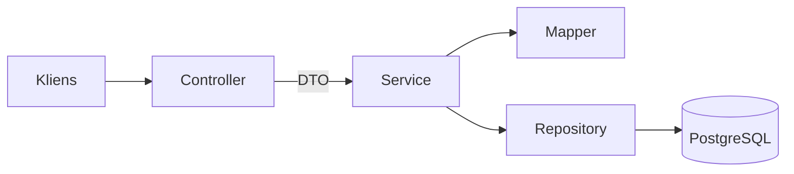
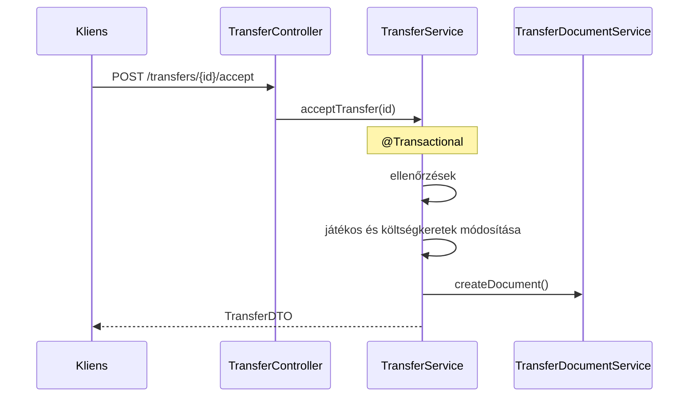
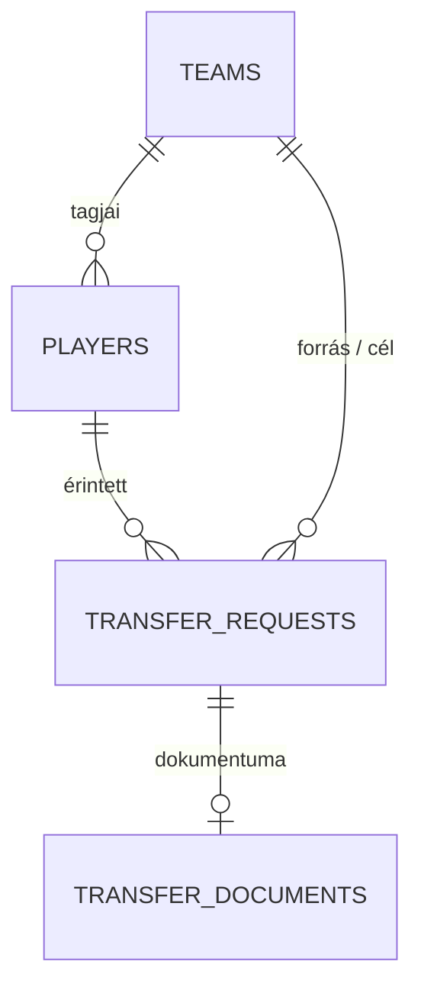

# HC Linear Football Transfer – saját megoldásom

Spring Boot alapú backend alkalmazás focicsapatok és játékosok kezelésére, átigazolási
kérelmekkel, átigazolási dokumentumokkal és PDF-exporttal.

## Technológiák

- Java 21, Spring Boot 3.2
- PostgreSQL 16 (Docker), Spring Data JPA
- Flyway (adatbázis-migráció)
- MapStruct (entity ↔ DTO átalakítás)
- Bean Validation
- springdoc-openapi (Swagger UI)
- OpenPDF (PDF generálás)

## Futtatás

1. Adatbázis indítása:

   ```bash
   cd development
   docker compose up -d
   ```

2. Az alkalmazás indítása a `dev` profillal:

   ```bash
   ./gradlew bootRun --args='--spring.profiles.active=dev'
   ```

3. Az alkalmazás a `http://localhost:8080` címen érhető el.
   A Flyway indításkor automatikusan lefuttatja a migrációkat.

## API dokumentáció

Swagger UI: <http://localhost:8080/swagger-ui.html>

| Terület | Végpontok |
|---|---|
| Csapatok | `POST /teams`, `GET /teams`, `GET /teams/{id}`, `DELETE /teams/{id}` |
| Játékosok | `POST /players`, `GET /players`, `GET /players/{id}`, `DELETE /players/{id}` |
| Átigazolások | `POST /transfers`, `GET /transfers?playerId=&sourceTeamId=&targetTeamId=`, `POST /transfers/{id}/accept`, `POST /transfers/{id}/reject` |
| Dokumentumok | `GET /transfer-documents`, `GET /transfer-documents/{id}`, `GET /transfer-documents/{id}/pdf` |

## Architektúra



- **Controller**: HTTP-réteg, bemeneti validáció (`@Valid`), csak DTO-kkal dolgozik.
- **Service**: üzleti logika és tranzakciókezelés.
- **Repository**: Spring Data JPA, adatbázis-hozzáférés.
- **Mapper**: entity és DTO közötti átalakítás (MapStruct).
- **Entity**: kizárólag az adatbázis-leképzés, az API-n nem jelenik meg.

### Átigazolás elfogadásának folyamata



### Adatmodell



## Üzleti szabályok

**Csapat:** egyedi név, az alapítás éve 1800 és a jelenlegi év között lehet.

**Játékos:** mezszám 1–99, minimum 15 éves, a piaci érték nem lehet negatív.
Csapatonként legfeljebb egy kapitány lehet, és csak csapattal rendelkező játékos lehet kapitány.

**Átigazolási kérelem:** a forrás csapat a játékos jelenlegi csapata (lehet üres),
a lejárati dátum nem lehet múltbeli. Állapotai: `OPEN`, `ACCEPTED`, `REJECTED`.

**Elfogadás:** csak nyitott, nem lejárt kérelem fogadható el. A cél csapatnak legfeljebb
25 játékosa lehet, és a költségkerete fedezze az összeget. Sikeres elfogadáskor a költségkeretek
módosulnak, a játékos csapata frissül (a kapitányság megszűnik), a játékosra vonatkozó többi
nyitott kérelem elutasításra kerül, és átigazolási dokumentum jön létre – mindez egy tranzakcióban.

**Dokumentum:** száma `ATIG` + 6 jegyű sorszám + `HU` formátumú (pl. `ATIG000014HU`).

## Hibakezelés

Minden hiba egységes formátumban jön vissza:

```json
{
  "type": "not_found",
  "message": "Nem található a csapat a 5 azonosítóval!",
  "details": []
}
```

| Státusz | Mikor |
|---|---|
| 400 | hibás kérés, validációs hiba |
| 404 | nem létező erőforrás |
| 409 | ütközés (pl. már létező csapatnév, betelt keret, már van kapitány) |
| 500 | váratlan hiba |

## Tervezési döntések

- **Kapitány**: logikai jelző a játékosnál. Az egyediséget az adatbázis (részleges egyedi index) és a service is védi.
- **Dokumentumszám**: PostgreSQL szekvenciából jön. Visszagördült tranzakció esetén kimaradhat egy sorszám, azonban ezt a kód egyszerűsége miatt jó kompromisszumnak tekintettem.
- **PDF összeg**: a dokumentumban rögzített átigazolási összeg szerepel PDF generálásakor, nem a játékos piaci értéke ahogy ez a feladatleírásban szerepel, mert a tényleges ár eltérhet a piaci értéktől.
- **Automatikusan lezárt kérelmek**: elutasított (`REJECTED`) állapotot kapnak, mivel a program szempontjából nem gondoltam hogy különbséget kell tenni automatiksan és kézileg elutasított átigazolási kérelmek között.
- **DTO-k**: az API entity-ket nem ad ki, a bemenet és a kimenet külön DTO, megvalósítva ezzel a feladat réteges architektúrára vonatkozó kiírását..
